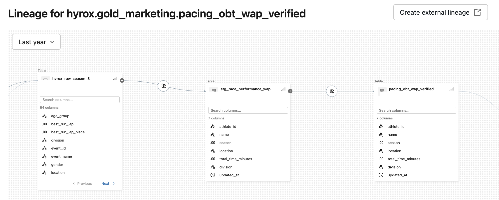

# HYROX Tiered SLA & Performance Analytics Pipeline using Databricks

For fans of Hyrox workouts, like my niece [Isabele](https://www.linkedin.com/in/isabele-rodman-60bb82293/) who is racing in November 2026 - very inspiring!  

## Hyrox-databricks-port

A Databricks port of the [hyrox-tieredsla-pipeline](https://github.com/ginobaltazar7/hyrox-tieredsla-pipeline) (Snowflake) medallion pipeline using the same data, same questions, but a different cloud.

> Live app: https://hyrox-databricks-port.onrender.com/ — verified live 2026-11-15. 


Why this port? To experiment and study the variations needed and patterns between one pipeline, one semantic model but differing warehouses. The Snowflake repo is the system of record; this repo proves the pipeline is portable in some aspects and gives the semantic layer (Apache Ossie) a second consumer. 

Data: the same 5,000-row Season 8 sample as the Snowflake repo — public HYROX results via the unofficial pyrox-client, not licensed HYROX data. Full provenance is in the [Snowflake repo README](https://github.com/ginobaltazar7/hyrox-tieredsla-pipeline)

## Architecture map (Snowflake → Databricks)

| Snowflake | Databricks |
|---|---|
| `RAW_BRONZE.HYROX_RAW_SEASON_8` | `bronze.hyrox_raw_season_8` (Delta) |
| `SILVER.stg_hyrox_races` (dbt incremental) | `silver.stg_hyrox_races` (Delta, dbt) |
| `GOLD_MARKETING.pacing_obt` | `gold_marketing.pacing_obt` (Delta, dbt) |
| SPCS dbt runner | Databricks SQL + AI/BI dashboards |
| Snowpark `raw_ingest.py` | `notebooks/01_ingest_bronze.py` |

## Repo layout

```
sql/          Delta DDL (catalog, schemas, bronze/silver/gold tables)
notebooks/    Ingestion notebook (parquet → Delta bronze)
dbt_project/          dbt project (databricks adapter) — silver + gold models
ossie/        Ossie semantic model YAML.
streamlit_app/  Streamlit app (Q1 bar, Q2 scatter + correlation table, Q5 notes panel), reading the frozen CSVs in `streamlit_app/data/` — see streamlit_app/README.md.
.github/workflows/  Weekly refresh chain (pull, refresh, land-by-hand) — see the weekly refresh section below.
scripts/      Refresh chain scripts (ingest trigger, gold CSV export, parquet land/pull) + the WAP gate.
```

## Phases

- [x] **0. Scaffold** — this repo: README, Delta DDL, ingestion notebook draft, dbt skeleton

- [x] **1. Free Edition setup** — sign up (personal email, no card), `databricks auth login`

- [x] **2. Bronze** — run DDL, run ingestion notebook → Delta bronze; 2026-10-21: mirrored [parse_split_minutes() from Snowflake](https://github.com/ginobaltazar7/hyrox-tieredsla-pipeline/commit/c8fc47299a28f2ee92320e098334b2d594bcd077) — best_run_lap text→minutes, NULLs preserved; bronze re-ingested + verified (5,000 rows, zero_laps = 0)

- [x] **3. Silver + Gold** — `dbt build` with the Databricks adapter (before the first build: pin dbt-core + dbt-databricks as a matched pair in requirements, the [Snowflake side's unpinned install pulled a beta dbt-core and broke snapshots](https://github.com/ginobaltazar7/hyrox-tieredsla-pipeline/commit/670edf159738e5d4e9fabf4f097551972fbfda5d))

- [x] **4. WAP + audits** — port the write-audit-publish gate and data-quality checks

- [x] **5. Semantic layer** — dbt semantic models, validated and queried with [MetricFlow](https://docs.getdbt.com/docs/build/build-metrics-intro?version=2) and exported as portable [Apache Ossie](https://github.com/apache/ossie-converters) YAML, export Databricks semantic layer

- [x] **6. Dashboards** — the Streamlit app lives in `streamlit_app/` (Q1 bar, Q2 scatter + correlation table, Q5 notes panel, mobile-first), reading the frozen CSVs in `streamlit_app/data/` (refreshed weekly by GitHub Actions; the PAT path is the fallback when the folder is absent) — the durable deployment, since Free Edition has no expiry. Q1 verified against the gold tables from a laptop (2026-11-14); Render deploy follows the repo copy. The Snowflake repo's version is the same front end against Snowflake tables.

- [ ] **7. Genie + MCP/RAG (next)** — Genie space over the gold tables, Unity Catalog functions, and an eval harness (scope B, decided 2026-11-13). Step 0 workspace checks in progress.

- [x] **8. Weekly refresh (automated)** — GitHub Actions pulls the full Season 8, runs the ingest notebook + dbt, and refreshes the frozen CSVs the app serves; see the weekly refresh section below.

## Lineage — clean split

- **Unity Catalog, here:** built-in table and column lineage in Catalog
  Explorer for the port tables, including `pacing_obt`, Q1, and Q2. This is
  the lineage layer for the Databricks side, no custom graph required.



Unity Catalog lineage for `pacing_obt_wap_verified` — WAP lineage only. (Slice 2, dbt-built `hyrox.gold_marketing.pacing_obt` lineage, is a separate open check; this image is not a substitute for it.)

- **Neo4j, Snowflake side:** the custom schema lineage graph lives in the
  Snowflake repo (`scripts/neo4j_load_schema.py`), not here. It is the
  cross-system graph, with gold tagged verified and bronze tagged unverified.

- **Apache Jena, later only:** formal ontology and inference, if lineage
  alone is not enough. Not part of v1.

### Sample questions Unity Catalog answers

- "What feeds `pacing_obt`?" — open the table in Catalog Explorer and
  follow its upstream lineage.

- "What depends on `q1_station_variance`?" — follow its downstream lineage
  in the same view.

- "Which columns feed `avg_station_degradation`?" — column-level lineage,
  not just table-level.

## Setup runbook (first green build, 2026-10-17)

1. Sign up at databricks.com/learn/free-edition → "For Personal Use" → **Free Edition**
   (not the 14-day trial). If signup rejects your email ("unable to signup, try a
   different email"), that address already has a Databricks identity — sign in instead,
   or use a different personal email.

2. Install the CLI: `brew install databricks/tap/databricks`; verify with
   `databricks version`.

3. `databricks auth login` → "Create a new profile" → paste the workspace host URL
   from the browser address bar (`https://dbc-XXXX-XXXX.cloud.databricks.com`, no
   trailing slash) → browser OAuth → "Authenticated".

4. Workspace → Create → Git Folder → paste the repo URL → Create. (Public repo:
   clone needs no credential; pushing back prompts GitHub OAuth once.)

5. Open `sql/01_delta_ddl.sql` and run it on the Serverless Starter Warehouse
   (2X-Small) → creates the `hyrox` catalog, the schemas, and the bronze table.

6. SQL Editor: `CREATE VOLUME IF NOT EXISTS hyrox.bronze.landing;`

7. Catalog → hyrox → bronze → landing → Upload → `hyrox_season_8.parquet`. (First build only — the pull workflow lands the full-season file weekly after that; see the weekly refresh section below.)

8. Open `notebooks/01_ingest_bronze.py`, attach to **Serverless** compute (not the
   SQL warehouse — Python needs serverless), Run all → Delta bronze table.

## Deliberate decisions and tradeoffs

- **Snowflake repo is the system of record.** Anything updated or pushed in
  `hyrox-tieredsla-pipeline` gets mirrored here. (Standing rule, 2026-10-17.)

- **Thin bronze, on purpose.** The notebook lands all columns as-is from the
  parquet and only adds identity columns (`athlete_id`, `result_id`,
  `updated_at`). Per-column sanitization (split parsing, missing → NULL) is a
  follow-up: a PySpark port of the Snowflake `parse_split_minutes`, then a clean
  re-ingest (minutes on a 5K-row sample).

  While the Snowflake repo had Pydantic row-by-row validation in Python, the Spark-idomatic equivalent on Databricks, schema-on-read which is an explicit schema on `spark.read` did not seem needed. Porting Pydantic would have been unnecessary. (see Bronze carries light conformance point below and again in No Pydantic on Databricks side)

  Also, the load-bearing check at this stage is the grain: result_id unique and non-null, which the notebook asserts before writing. So electing to perform the validations at the latter stage of the Medallion, into Silver and Gold.

- **Identity recipe is exact-parity with Snowflake.** The first notebook draft
  used `sha256(event_id|athlete_id)` for synthetic `result_id`s; the Snowflake
  `raw_ingest.py` uses `sha256(event_id|name|division|total_time)` with a
  `res_synth_` prefix (16-char truncation), falling back to synthetic on null
  *or blank* source IDs, and `ath_` + 16-char `athlete_id`s. 
  
  The draft's recipe produced 2 duplicate `result_id`s on the sample (same athlete, same event, two races) that Snowflake's recipe distinguishes — caught by the grain assert. Fixed 2026-10-17; the assert now guards the parity.

- **Bronze carries light conformance — deliberately, for now.** Textbook
  medallion says bronze is raw and immutable, with dedupe and key derivation in
  silver, which was my original instinct to do. 
  
  Industry practice IMHO though and this is designed into the Snowflake pipeline this ports derives identity keys at bronze ingest. Refactoring to pure-raw bronze would
  ripple into the dbt silver models, which expect `result_id`/`athlete_id` to
  exist; deferred as a conscious call at the gate, not an oversight. The
  dupe-handling rule (quarantine vs. fail vs. dedupe) belongs to Phase 4
  (WAP + audits), where the write-audit-publish gate is its natural home.
  During the port, bronze asserts fail loud.

- **No Pydantic on the Databricks side.** Pydantic validates row-by-row in
  Python, which is upstream of how Spark works. The Spark-idiomatic equivalent is
  schema-on-read plus column checks and which lands with the sanitization
  follow-up. The load-bearing check today is the grain assert (`result_id`
  unique, non-null) before write.

- **Python notebooks run on Serverless compute, not the SQL warehouse.** The
  Starter Warehouse is SQL-only; the notebook's environment panel dependencies
  (simplejson, requirements.txt) are not needed and were skipped.

## Databricks Free Edition constraints (verified)

- Serverless only; single 2X-Small SQL warehouse. Auth is OAuth via `databricks auth login`, then `auth_type: oauth` in `dbt_project/profiles.yml` — for dbt. A Personal Access Token (PAT) is in use for the Streamlit app on Render (created 2026-11-11, 90-day, comment `hyrox-streamlit-render`, expires ~2027-02-09; rotation reminder set for 2027-01-28). Service-principal OAuth (M2M) may 401 on Free Edition before any permission is checked — that is the Free limit, not a grants problem. The PAT runs as the workspace user, so it carries that user's permissions.

- Catalog creation goes through SQL on the warehouse (the Free Edition metastore
  has no storage root, so CLI/API catalog creation fails).

- Fair-use quota: compute will shut down if Databricks detects a daily compute threshold is exceeded, however data and settings are kept. 

- Serverless notebooks can only reach Databricks-approved internet domains, so test the Neo4j Bolt connection from a notebook before building the graph step. If it's blocked, fall back to running the sync from your laptop, pulling the data through the Databricks SQL connector.

- Signup terms reserve the right to train on workspace data. The Hyrox dataset is
  public scraped race results, so exposure is nil. Still, keep the client or
  proprietary data out of this workspace.

## Hyrox Fresh Data Kit — weekly refresh (2026-11-20)

The app serves frozen CSVs from `streamlit_app/data/`, so it never touches
Databricks at request time. A weekly GitHub Actions chain keeps those CSVs
fresh; a failed run leaves the old CSVs serving, so the app never breaks.

- **Pull** — Mondays 02:00 UTC, `.github/workflows/pull-season.yml`: the
  runner pulls the full Season 8 with pyrox-client (open internet, like
  Colab), validates the parquet, and lands it in the Volume
  `hyrox.bronze.landing`, then triggers the refresh. No Colab step.
- **Refresh** — Mondays 03:00 UTC, `.github/workflows/refresh-data.yml`:
  submits the ingest notebook as a one-time Jobs API run on serverless,
  runs `dbt build`, exports the two gold tables to CSVs with a validation
  gate, and commits only if the CSVs changed. Render redeploys on the commit.
- **Land by hand** — `.github/workflows/land-parquet.yml`: paste a direct
  download URL (a link-shared Drive file, or a raw URL from the Snowflake
  repo) and it downloads, validates, and lands the file, optionally
  triggering the refresh.

Setup: five repo secrets — `DATABRICKS_HOST` (workspace URL with scheme,
SDK only), `DATABRICKS_SERVER_HOSTNAME` (bare hostname, SQL connector and
dbt), `DATABRICKS_HTTP_PATH`, `DATABRICKS_TOKEN` (the PAT), and
`DATABRICKS_NOTEBOOK_PATH` (workspace path of the ingest notebook, no `.py`).
The PAT needs the `jobs`, `workspace`, `files`, and `sql` scopes — the token
created for the Streamlit app only carried `sql`, and a Jobs API call 403s
without them (Settings → Developer → Access Tokens → Manage → Update token).

Proven 2026-11-19: the pull fetched 715,728 rows x 51 columns in 61.7s, and
a manual Jobs API submit returned a `run_id`, so Free Edition accepts Jobs
API submits — the earlier 403 was the token's scopes, not a Free Edition wall.

Know before the first run: the export sorts deterministically, so the first
successful refresh reorders the CSV rows and nothing else. Apply
`notebook-sample-change.diff` before the first pull lands the big file: it
makes the notebook draw a deterministic, exact 5,000-row sample in Spark
(hash of each row's identity fields, 5,000 smallest hashes) before the
identity rules, so bronze stays the 5,000-row sample — but the frozen
numbers move to the new draw, and the gist/demo recording still quotes
the old ones until refreshed. The Volume is not versioned: the pull itself is
the backup. The PAT expires ~2027-02-09.

The package also carries the Nov 20 code-review fixes: hash-based sampling
in the notebook diff, a WAP gate that halts on 10 or fewer rows, a 5,000-row
floor on landed and pulled files, and an ingest timeout that cancels the
abandoned run before failing.

## Getting started

```bash
git clone https://github.com/ginobaltazar7/hyrox-databricks-port.git
cd hyrox-databricks-port
```

<sub>Parts of this project, including documentation and analysis, were developed with assistance from Naru, an AI assistant.</sub>